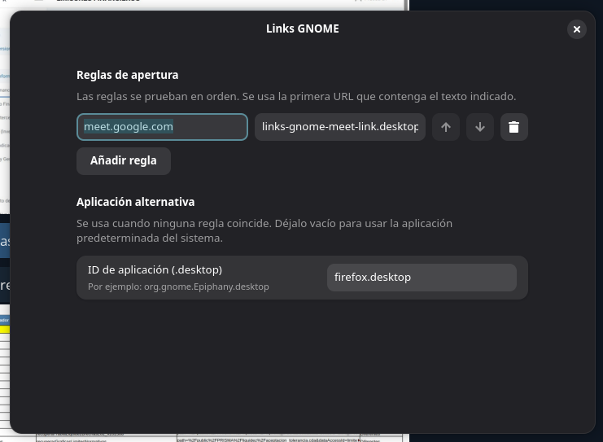

# Links GNOME

Extensión de GNOME Shell para abrir enlaces HTTP/HTTPS con una aplicación
elegida según el texto que aparezca en la URL. Por ejemplo, se puede enviar
`https://meet.google.com/...` a una aplicación o instancia concreta.

## Captura de pantalla



## Requisitos

- GNOME Shell 45 o posterior.
- `gjs`, `glib-compile-schemas` y `xdg-mime`.

## Instalación

Desde la raíz del proyecto, ejecuta:

```sh
sh scripts/install.sh
gnome-extensions enable links-gnome@jpupo91
```

La instalación no cambia por sí sola el navegador predeterminado. Para que el
escritorio entregue los enlaces HTTP/HTTPS a la extensión, registra el
manejador:

```sh
xdg-mime default links-gnome-url-handler.desktop x-scheme-handler/http
xdg-mime default links-gnome-url-handler.desktop x-scheme-handler/https
```

Después, abre las preferencias desde el icono de la extensión en la barra
superior. Añade una regla con un texto de URL (por ejemplo,
`meet.google.com`) y el ID de escritorio de la aplicación que debe abrirla.
Las reglas se prueban de arriba hacia abajo y la primera coincidencia gana.
El ID suele ser el nombre del archivo `.desktop` de la aplicación, por
ejemplo `org.gnome.Epiphany.desktop`.

Configura también una aplicación alternativa para los enlaces que no coincidan
con ninguna regla. Esto evita que esos enlaces vuelvan a invocar el manejador
cuando este sea el predeterminado. Si la aplicación alternativa está vacía, se
usa la aplicación predeterminada del sistema, siempre que no sea este mismo
manejador.

## Publicar en GNOME Extensions

Crea el paquete que se sube a [extensions.gnome.org](https://extensions.gnome.org/):

```sh
sh scripts/package.sh
```

El archivo resultante es `dist/links-gnome@jpupo91.shell-extension.zip`.
Entra en la página de tu extensión en GNOME Extensions y súbelo desde la
opción de carga de una versión nueva. El paquete contiene la extensión de
GNOME y su esquema de preferencias. La integración con enlaces HTTP/HTTPS es
un componente adicional: para usarla, clona este repositorio y ejecuta
`sh scripts/install.sh`; luego registra el manejador con los comandos de la
sección de instalación.

## Desinstalación

Desactiva la extensión y elimina los archivos instalados:

```sh
gnome-extensions disable links-gnome@jpupo91
rm -r "$HOME/.local/share/gnome-shell/extensions/links-gnome@jpupo91"
rm "$HOME/.local/share/applications/links-gnome-url-handler.desktop"
```

Si registraste el manejador como predeterminado, vuelve a seleccionar tu
navegador con `xdg-mime default` para ambos esquemas.
